<h2 align="center">The Four Banners</h2>

<!-- TODO: add metric -->

<a href="https://aryan-kumar-portfolio-eight.vercel.app/">Portfolio</a> · <a href="https://github.com/alpha730">GitHub</a>

