<!-- Generated by scripts/build.mjs from profile.config.json. Edit the config, then run npm run build. -->



<a href="https://github.com/alpha730/Prompt-injection-Tester-"></a>

<a href="https://github.com/alpha730/Prompt-injection-Tester-"><b>Prompt-injection robustness study</b></a> 
LangGraph agent (Qwen via Groq) answering remote-sensing questions over Sentinel-2 NDVI, Sentinel-1 water extent and ERA5 rainfall for 6 Indian regions. 20 tasks, 5 injection styles (incl. Hindi), 2 defenses, 660 runs. <i>0 of 600 attacked runs led to a harmful action. Task success 96.5-100%.</i> 
<code>LangGraph</code> · <code>Qwen via Groq</code> · <code>Sentinel-1/2</code> · <code>ERA5</code>

<a href="https://github.com/alpha730/sih-project"></a>

<a href="https://github.com/alpha730/sih-project"><b>AI-Powered Remote Sensing Analysis Platform</b></a> 
Agentic Earth-observation system on SAR + optical imagery with visual question answering (VQA). 
<code>Python</code> · <code>PyTorch</code> · <code>LangGraph</code> · <code>Rasterio</code>

<!-- TODO: add metric -->

<a href="https://github.com/alpha730/ASHA-Voice-Logging-Agent"></a>

<a href="https://github.com/alpha730/ASHA-Voice-Logging-Agent"><b>ASHA Voice Logging Agent</b></a> 
Multilingual (Hindi, English, Marwari) voice agent turning home-visit reports into structured health records. Sarvam Saaras v3 STT, LLM extraction, Supabase. Safety-first IMNCI triage with a deterministic, source-cited rules engine. <i>139 automated tests.</i> 
<code>Next.js</code> · <code>TypeScript</code> · <code>Supabase</code> · <code>Sarvam Saaras v3</code>

<a href="https://github.com/alpha730/DUO-Game"></a>

<a href="https://github.com/alpha730/DUO-Game"><b>Decade Hunt: Duolingo English Test AR game</b></a> 
AR game for Duolingo's 10-year campaign. Scan posters to catch "Lingos"; level system with streaks. <i>Played at a campus event on Oct 22, 2026.</i> 
<code>React</code> · <code>TypeScript</code> · <code>MindAR</code> · <code>Firebase</code>


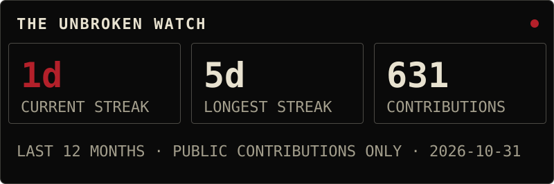

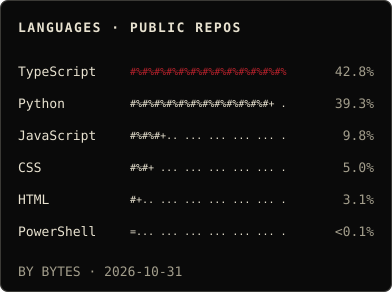
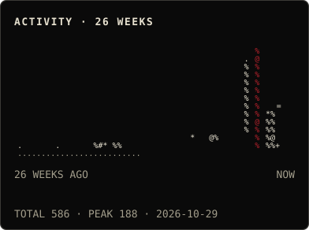


<a href="https://aryan-kumar-portfolio-eight.vercel.app/">Portfolio</a> · <a href="https://github.com/alpha730">GitHub</a>

