<!-- Generated by scripts/build.mjs from profile.config.json. Edit the config, then run npm run build. -->

<a href="https://aryan-kumar-portfolio-eight.vercel.app/"></a>

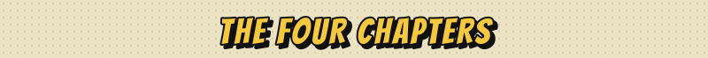

<a href="https://github.com/alpha730/Prompt-injection-Tester-">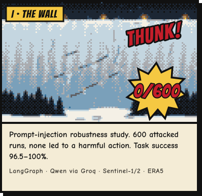</a>
<a href="https://github.com/alpha730/sih-project">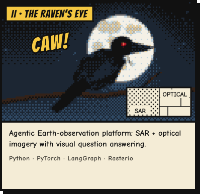</a>
<!-- TODO: add metric -->

<a href="https://github.com/alpha730/ASHA-Voice-Logging-Agent">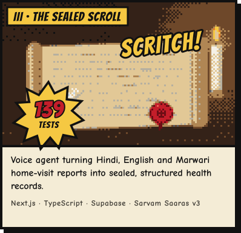</a>
<a href="https://github.com/alpha730/DUO-Game">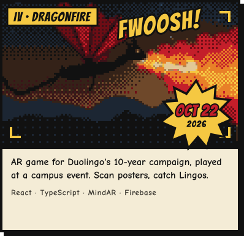</a>

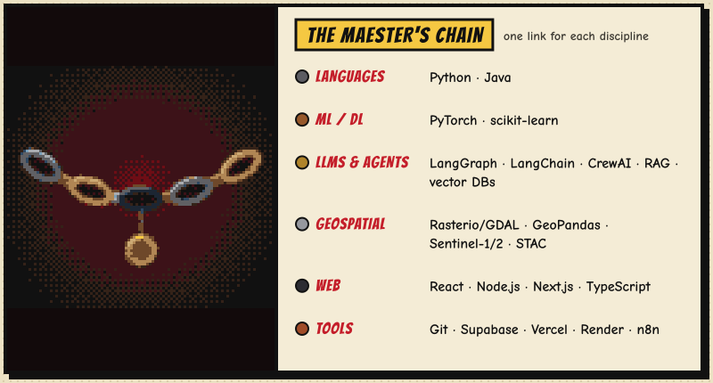

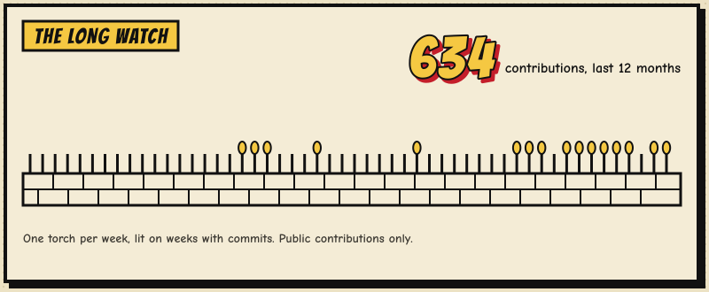

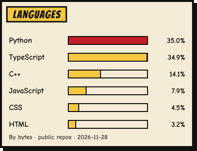
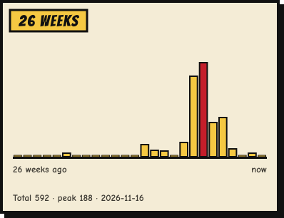


<a href="https://aryan-kumar-portfolio-eight.vercel.app/"><b>Portfolio</b></a> · <a href="https://github.com/alpha730"><b>GitHub</b></a>

<a href="https://github.com/alpha730/Prompt-injection-Tester-">I · The Wall</a> · <a href="https://github.com/alpha730/sih-project">II · The Raven's Eye</a> · <a href="https://github.com/alpha730/ASHA-Voice-Logging-Agent">III · The Sealed Scroll</a> · <a href="https://github.com/alpha730/DUO-Game">IV · Dragonfire</a>

